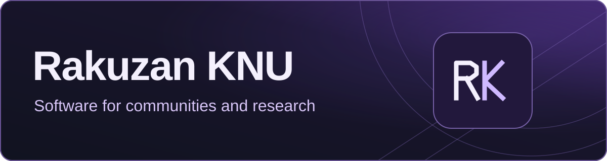

We build web applications for social and research communities. Our projects use React and TypeScript on the web and NestJS on the backend.

## Projects

### [Eternal](https://github.com/rakuzan-knu/Eternal)

A team-built social network with feeds, profiles, and real-time messaging.

[Documentation](https://github.com/rakuzan-knu/Eternal/blob/main/docs/README.md) · [Issues](https://github.com/rakuzan-knu/Eternal/issues)

### [VIRaTeC](https://github.com/rakuzan-knu/VIRaTeC)

A bilingual platform for the research community at Taras Shevchenko National University of Kyiv, with directories for projects, publications, and researchers.

[Documentation](https://github.com/rakuzan-knu/VIRaTeC/tree/main/docs) · [Issues](https://github.com/rakuzan-knu/VIRaTeC/issues)

## Report a security issue

Use GitHub’s private reporting form for [Eternal](https://github.com/rakuzan-knu/Eternal/security/advisories/new) or [VIRaTeC](https://github.com/rakuzan-knu/VIRaTeC/security/advisories/new).

## Support development

You can support [@subvincdebian](https://github.com/subvincdebian)’s development work through [his Patreon](https://www.patreon.com/cw/subvincdebian).
